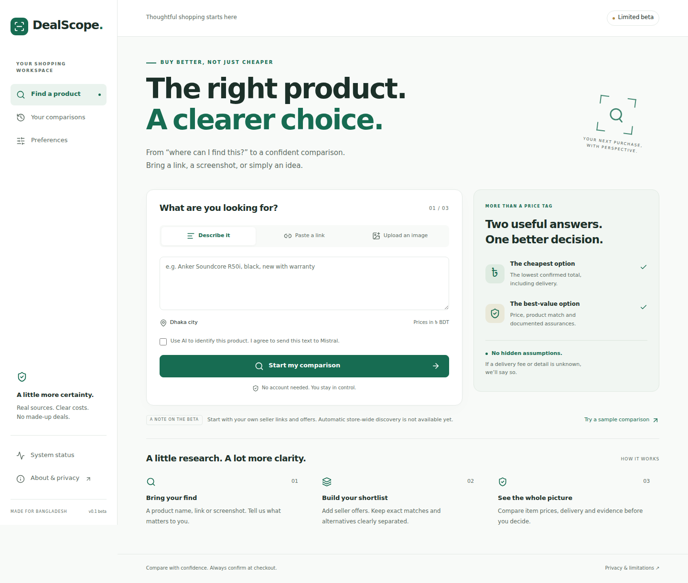

# DealScope

A mobile-first shopping comparison workspace for Bangladesh. Bring a product description, seller link or screenshot; confirm the product; collect offers; compare prices, delivery and evidence.

**v0.1.0-beta.1 — limited beta.** Manual comparison is functional without credentials. This is **not yet a live, comprehensive Bangladesh shopping search engine**. Automated store-wide discovery is unavailable. Seller links and user-entered offers are the dependable path. No demo price is presented as a real offer.

## What works

- English/Bangla text input and editable product identity, variant, condition, quantity, required/excluded features.
- Optional server-side Mistral text/vision identification with explicit consent, schema validation and quota/unavailable fallback.
- Screenshot processing with size, signature and decoding limits; EXIF removed through re-encoding.
- Facebook Reel fallback directly to a product description or screenshot, without claiming to have watched it.
- Manual seller offers, public HTTPS source links, unknown/ranged shipping, other mandatory fees, and evidence timestamps.
- Exact/likely/similar/rejected matching; separate cheapest-confirmed and evidence-based best-value outcomes.
- Provisional lowest user-entered total, explicitly unverified. Manual/demo entries cannot become verified winners.
- Filters, refresh of extracted evidence, local history, saved comparisons, JSON export, delete/clear, light/dark/system themes.
- Installable PWA manifest/icons and an offline help page. Offline search is not supported.
- Safe public diagnostics, security headers, bounded requests, tests and CI.

## Screenshots

Actual production-rendered UI (the sample comparison contains explicitly fictional offers).



[Mobile view](docs/screenshots/home-mobile.png) · [Sample comparison](docs/screenshots/sample-comparison.png)

## Run locally

Requires Node 22.14+ (Node 24 also tested), npm, and a modern browser.

```sh
npm ci
cp .env.example .env.local
npm run dev
```

Open http://localhost:3000. Leave `AI_ENABLED=false` for manual-only use. A database, account and paid search API are not required.

```sh
npm run lint
npm run typecheck
npm test
npm run build
npx playwright install --with-deps chromium
npm run test:e2e
npm start
```

`npm run test:e2e` starts the production server; run the build first. CI uses mocked services and disables live AI/extraction. See [release evidence](docs/RELEASE-CHECKLIST.md).

## Optional Mistral

Set server-only `MISTRAL_API_KEY`, choose `MISTRAL_TEXT_MODEL` and optionally `MISTRAL_VISION_MODEL` from models your account can actually access, then set `AI_ENABLED=true`. Never prefix the key with `NEXT_PUBLIC_`, put it in source control, or paste it into the app.

```sh
node --env-file=.env.local --import tsx scripts/check-models.ts
```

Model discovery lists model IDs/capabilities without printing credentials. Availability does not establish free-tier eligibility; check your account's plan and quotas. No model, unlimited allowance or paid fallback is assumed. The owner’s account has **not** been tested because no key was supplied.

At most two calls per identification (second only for schema repair); 429/5xx trigger cooldown. Default application budget: 20 calls/day **per running process**, not a global account cap. Set provider-side limits and protect the deployment before enabling AI publicly. Do not enable billing to use this beta.

## Seller coverage

The generic structured-data parser is restricted to opt-in, user-submitted `www.startech.com.bd` product pages. It requires current robots permission, refuses redirects/search URLs, accepts only one unambiguous BDT `Offer`, and leaves unsupported fields unknown. `STARTECH_EXTRACTION_ENABLED=false` by default. This path is implemented and fixture-tested, **not live-certified**. Review [source coverage](docs/SOURCE-COVERAGE.md) before enabling.

Ryans extraction is excluded because its published terms prohibit automated data gathering. Daraz and Pickaboo are manual-only pending permission/access review. Google links are external search leads, not an integrated search API.

## Deploy

The repository contains Vercel-compatible configuration. No DealScope Vercel project existed at inspection. No production deployment or release tag is claimed. Follow [deployment instructions](docs/DEPLOYMENT.md) once the owner authorizes hosting. Deploy manual mode first; enabling AI is a separate operator configuration step.

## Documentation

- [Product requirements](docs/PRODUCT-REQUIREMENTS.md) · [Architecture](docs/ARCHITECTURE.md)
- [API](docs/API.md) · [Decisions](docs/DECISIONS.md)
- [Source coverage](docs/SOURCE-COVERAGE.md) · [Known limitations](docs/KNOWN-LIMITATIONS.md)
- [Privacy](docs/PRIVACY.md) · [Security](docs/SECURITY.md)
- [Troubleshooting](docs/TROUBLESHOOTING.md) · [Release checklist](docs/RELEASE-CHECKLIST.md)
- [Changelog](CHANGELOG.md) · [Next milestones](docs/BACKLOG.md)

The original owner handoff is retained as `DEALSCOPE-AUTONOMOUS-BUILD-HANDOFF.md`. Implementation deviations and unresolved exit gates are explicit in the documentation. Created for Ismail Hossain ([smile-plzz](https://github.com/smile-plzz)). No seller endorsement or affiliate relationship is implied. No open-source license has been selected by the owner.
