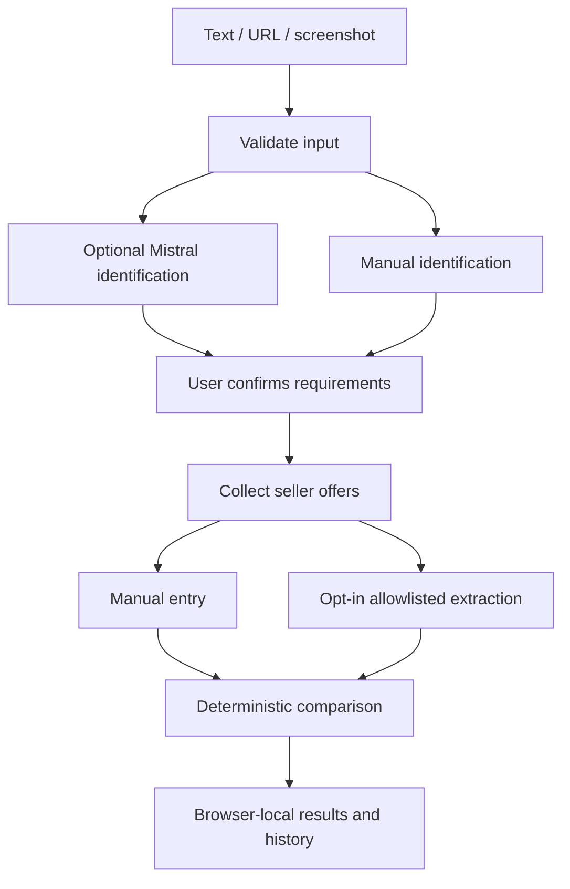

# Architecture

Next.js App Router and TypeScript. Server routes use Zod at untrusted boundaries. No database and no mandatory account.

- `src/lib/schema.ts`: input, product intent, offer and evidence schemas.
- `src/lib/comparison.ts`: conservative matching, fees/ranges, freshness, cheapest and best value, canonical deduplication.
- `src/lib/url.ts`, `server-http.ts`: URL policy, IP validation and socket pinning. Manual URLs are validated but not fetched.
- `src/lib/extraction.ts`: bounded cache and source circuit breaker; robots checks; structured-data parsing. Only Star Tech host can be fetched, when enabled.
- `src/lib/ai`: server-only Mistral calls, response validation, image decoding, repair budget and cooldown; versioned identification prompt.
- `src/lib/api.ts`: bounded JSON reads, same-origin browser writes, best-effort hashed-IP throttling, stable sanitized errors.
- `src/lib/storage.ts`: versioned, Zod-validated browser storage with 30-day retention and 30-session cap.
- `src/components`: home/intent confirmation, results/manual offers, history/preferences/status, common shell.

Search finishes synchronously and returns data for browser storage. No server-memory job IDs are exposed as durable resources. `/search/[id]` redirects to the locally backed results route. Repeated requests have no durable server-side side effects; extraction is cached, but search IDs are not idempotency keys.

The current source restriction is stronger than a generic extractor: public HTTPS seller links can be recorded manually, but server-side network fetching is fixed-host only. Public diagnostics return static configuration states, not live connectivity assertions.

Local storage is not a tamper-proof verification database. Price provenance from this app is useful to the local shopper; exported/shared data cannot serve as authenticated merchant evidence. A future shared architecture needs durable storage, isolation, evidence signatures and distributed rate limiting.
